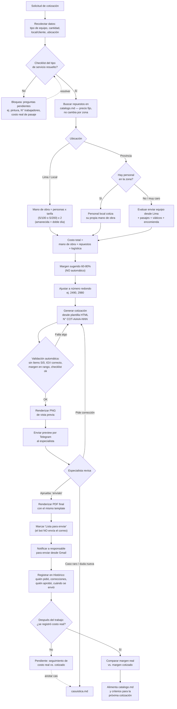

# Flujo completo del proceso de cotización

Diagrama de referencia de punta a punta: desde que llega la solicitud hasta que el correo sale
y se retroalimenta el sistema con el costo real. Cada bloque corresponde a una regla ya
decidida en `criterios-actuales.md`.

## Formato de la vista previa (paso "Renderizar PNG") — decidido

**Imagen PNG**, no PDF ni texto plano, enviada como foto en Telegram. Razón: una imagen se ve
inline al instante en el chat (sin tocar ni descargar nada), y sí muestra el diseño real
(logo, colores, tabla) — a diferencia del texto plano. Un PDF sí muestra el formato, pero en
Telegram llega como documento que hay que abrir aparte, un paso extra en cada revisión.

Para no duplicar trabajo ni arriesgar que la vista previa y el PDF final se vean distintos: se
arma **una sola plantilla HTML** por tipo de servicio, hecha de la imagen real del encabezado
(logo, marca, curvas, título del servicio) + el N° de cotización superpuesto como texto real
(ver `plantilla/README.md` para el detalle técnico y por qué no se recreó el diseño desde
cero). Esa misma plantilla se renderiza a PNG para la vista previa rápida, y a PDF solo cuando
ya está aprobada, para el envío real por correo.
