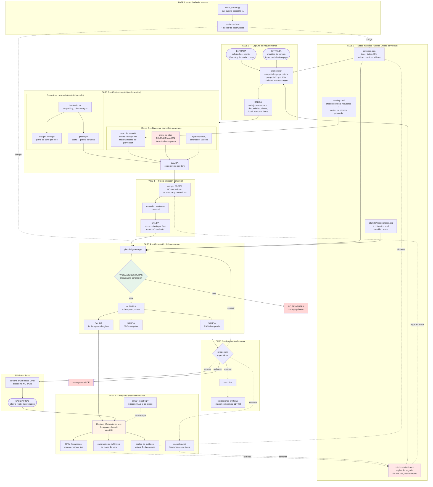
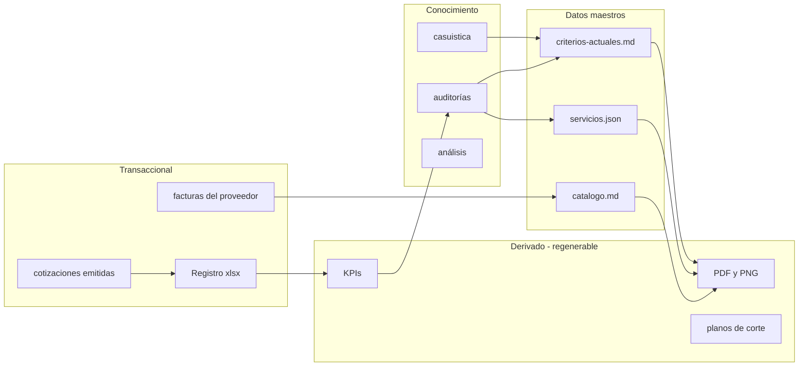
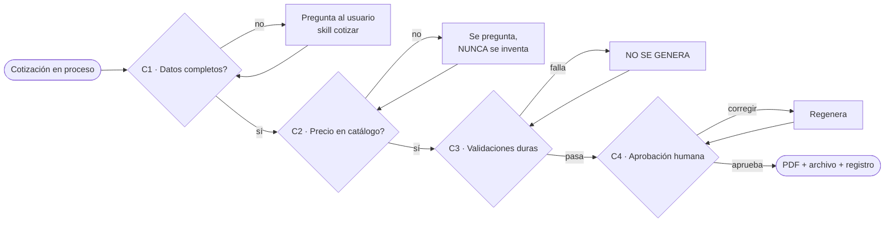

# Flujograma del sistema completo — entradas, salidas y control por subproceso

Mapa de punta a punta de TODO lo construido hasta el 19/09/2026. A diferencia de
`flujo-completo.md` (que describe el proceso de negocio de cotizar) y de
`herramientas/flujo-calculo.md` (que describe solo el cálculo de laminado), este documento mapea
**el sistema como sistema**: qué subproceso existe, qué entra, qué sale, quién lo consume, qué lo
valida y qué todavía es manual.

Cada nodo del diagrama corresponde a un archivo real de este repositorio. Si un nodo no tiene
archivo detrás, está marcado como pendiente — no se dibuja nada que no exista.

---

## 1. Diagrama maestro

**Leyenda de colores**: rojo claro = regla que vive en prosa y se re-interpreta cada vez (riesgo
identificado en `auditoria-arquitectura-2026-09-19.md`); naranja = paso manual sin automatizar;
verde = control automático que sí funciona.

---

## 2. SIPOC por subproceso

Tabla clásica de ingeniería de procesos: quién provee la entrada, qué entra, qué hace el
proceso, qué sale, y **quién consume esa salida** (la audiencia).

| # | Subproceso | Proveedor de la entrada | Entrada | Salida | Audiencia de la salida |
|---|---|---|---|---|---|
| 1 | Captura del requerimiento | Cliente / técnico de campo | Descripción libre, medidas, fotos | Trabajo estructurado (tipo, subtipo, ítems) | El propio sistema (fase 2) |
| 2A | Cálculo de rollos (laminado) | Fase 1 | Medidas de cada pieza | N° de rollos, largo, plano de corte | Técnico en campo + fase 3 |
| 2B | Costeo de componentes | `catalogo.md` + facturas del proveedor | Lista de repuestos a cambiar | Costo de material por ítem | Fase 3 |
| 2C | Mano de obra | `criterios-actuales.md` (prosa) | Personas, tarifa, localidad | Costo de mano de obra | Fase 3 |
| 3 | Decisión de precio | Fase 2 + criterio comercial | Costo total + margen | Precio unitario por ítem | Fase 4 |
| 4 | Generación del documento | Fase 3 + `servicios.json` + plantilla | JSON de la cotización | PNG, PDF, fila de registro | Especialista (revisión) |
| 5 | Aprobación | Fase 4 | PNG de vista previa | Aprobado / corregir / rechazado | Responsable de envío |
| 6 | Envío | Fase 5 | PDF aprobado | Cotización en manos del cliente | **Cliente** |
| 7 | Registro | Fases 4, 5, 6 + resultado real del trabajo | Fila + estado + costos reales | KPIs, calibración, conteo de subtipos | Dueño del negocio (decisiones) |
| 8 | Auditoría | Todo lo anterior + log de sesión | Repo completo + JSONL | Hallazgos y correcciones | El sistema mismo (mejora) |

**Observación de sistemas**: solo el subproceso 6 tiene al cliente como audiencia. Todo lo demás
es consumo interno. Eso significa que un error en 1–5 es recuperable sin costo externo, pero un
error que llega a 6 ya es un compromiso de precio frente al cliente — por eso las validaciones
duras están en la fase 4 y la aprobación humana en la 5, antes de ese punto de no retorno.

---

## 3. Clasificación de datos (criterio de sistemas: maestro / transaccional / derivado)

| Tipo de dato | Qué es | Archivos | Regla de manejo |
|---|---|---|---|
| **Maestro** | Cambia poco, se consulta siempre, una sola fuente | `servicios.json`, `catalogo.md`, `criterios-actuales.md`, `plantilla/` | Nunca se duplica. Si un valor está en dos lugares, uno está mal. |
| **Transaccional** | Un registro por evento real, crece con el tiempo | `cotizaciones-emitidas/`, `balanzas-industriales/cotizaciones-reales/`, `proveedor-gufra/`, Registro xlsx | Se agrega, no se corrige el pasado. |
| **Derivado** | Se puede regenerar desde los otros dos | PNG, PDF, planos de corte, fila de registro, KPIs | No se versiona lo que se puede recalcular (por eso el `.gitignore`). |
| **Conocimiento** | Por qué se decidió algo | `casuistica.md`, `analisis/`, `auditoria-*.md` | Se agrega, no se borra. Es lo que evita repetir un error ya cometido. |

**Lectura clave del diagrama**: el ciclo `facturas → catálogo → cotización → registro → KPI →
auditoría → reglas` está **cerrado**. Eso es lo que permite que el sistema aprenda de cada trabajo
en vez de empezar de cero. El único eslabón que hoy es manual es `registro`.

---

## 4. Matriz de validación de criterios — dónde se hace cumplir cada regla

Esta es la tabla para auditar: cada regla del negocio, y **quién garantiza que se cumpla**.

| Regla de negocio | Documentada en | ¿La valida el código? | Riesgo si falla |
|---|---|---|---|
| El título no se escribe a mano, sale del tipo | `servicios.json` | **Sí** — `generar.py` se niega a correr | Bajo |
| Un servicio `generales` exige subtipo válido de la lista | `servicios.json` | **Sí** — corta con la lista de válidos | Bajo |
| Ningún ítem en S/0 ni cantidad 0 | `criterios-actuales.md` p.9 | **Sí** — bloquea la generación | Bajo |
| Subtotal nunca negativo | (agregado 17/09) | **Sí** — bloquea | Bajo |
| Ítem sin precio debe ser explícito (`pendiente`), no un olvido | (agregado 19/09) | **Sí** — bloquea el olvido, permite lo explícito | Bajo |
| IGV 18% y validez 15 días | `servicios.json` | **Sí** — se leen de ahí, no se escriben | Bajo |
| N° de cotización con formato correlativo | `criterios-actuales.md` p.7 | **Alerta, no bloquea** | **Medio — en la práctica se usa otro formato** |
| Margen 60–80%, nunca automático | `criterios-actuales.md` p.4 | **No** — solo prosa | **Alto — se re-interpreta cada vez** |
| Mano de obra = personas × tarifa × 2 por amanecida | `criterios-actuales.md` p.2 | **No** — cálculo a mano | **Alto — se calculó distinto 2 veces el mismo día** |
| Piso mínimo S/250 por carretilla | `criterios-actuales.md` p.4 | **No** | Medio |
| Precio de repuesto solo desde `catalogo.md` | `catalogo.md` | **No** — depende del criterio humano | Medio |
| No exponer nombres de contacto en archivos del repo | skill `cotizar` | **No** — se corrigió a mano tras la auditoría | Medio |

**Conclusión de la matriz**: 6 reglas están endurecidas en código y 6 dependen de que alguien las
recuerde. Las dos de mayor riesgo (margen y mano de obra) son exactamente las que determinan el
precio final — es decir, **lo más caro de equivocar es lo menos protegido**. Esa es la prioridad
1 de `auditoria-arquitectura-2026-09-19.md`.

---

## 5. Estado de automatización por subproceso

| Subproceso | Estado | Qué falta para automatizarlo |
|---|---|---|
| Captura del requerimiento | **Semi** — conversación libre, con confirmación | Nada crítico; funciona |
| Cálculo de rollos y plano de corte | **Automático** | Nada |
| Costeo de material | **Semi** — catálogo existe, se aplica a mano | Un `costeo.py` que lo lea |
| Mano de obra | **Manual** | `criterios.json` + `costeo.py` |
| Decisión de precio | **Manual a propósito** | No automatizar: es criterio comercial |
| Generación del documento | **Automático** | Nada |
| Aprobación | **Manual a propósito** | No automatizar hasta definir umbral por monto |
| Archivado | **Automático con `--archivar`** | Guardar también el JSON de costeo |
| Registro | **Manual** | API de Google Sheets (evaluar tras el mes de prueba) |
| Auditoría de costo de IA | **Automático** | Nada |

---

## 6. Puntos de control (dónde se detiene el flujo si algo está mal)

Cuatro puntos de control antes de que un precio salga al cliente. C3 es el único totalmente
automático; C1, C2 y C4 dependen de la conversación y del criterio humano — por diseño, no por
falta de desarrollo.

---

## 7. Auditoría del propio mapa: vacíos, duplicados, reprocesos y bugs (19/09/2026)

Revisión de este flujograma contra lo que realmente ocurrió al construirlo. Todo lo de abajo
está verificado contra el repo, no afirmado de memoria.

### 7.1 Vacíos — existe en la realidad, no está en el diagrama

| # | Vacío | Evidencia | Por qué importa |
|---|---|---|---|
| V1 | **Falta el subproceso completo de COMPRA** (cotizar al proveedor → proforma → orden → factura → guía de remisión) | 15 PDF reales en `balanzas-industriales/proveedor-gufra/`, incluida la factura F001-72 pagada | Es el **origen del costo de material**. El diagrama muestra `catalogo.md` como dato maestro pero no cómo se alimenta. Media cadena de valor sin mapear. |
| V2 | **La fuente primaria de los costos no está en el repo** | El chat de WhatsApp con el proveedor vive solo en esta conversación; no hay ningún `.txt` en el repo | `analisis-proveedor-gufra.md` preserva las conclusiones, pero si se pierde el chat no hay forma de re-verificar de dónde salió cada precio |
| V3 | **El tipo de cambio USD→PEN no tiene hogar** | `grep` de "tipo de cambio" en JSON y PY: **cero resultados**. El S/3.51 vive en prosa | Es una entrada directa del costeo (el indicador T-Scale se cotiza en dólares). Sin dato maestro, cada cotización lo re-asume |
| V4 | **No existe el estado "borrador con pendientes"** | `cotizacion-santa-anita-borrador.md` vivió 2 días esperando un costo | El diagrama dibuja una línea recta captura→costeo→precio→generación; la realidad tiene un bucle de espera que puede durar días |
| V5 | **`ejemplos-reales/` y `analisis/` no aparecen** como fuentes | Ambas carpetas existen y se usaron para decidir formato y precios de referencia | Son entrada real de la fase 1 y 3 |
| V6 | **La hoja de costos editable no está en el repo ni en el diagrama** | El script que generó `COT-2026-002-editable.xlsx` vive en `/tmp`, no en `herramientas/` | Subproceso real ("el dueño ajusta costos en Excel") sin representar, y **no reproducible**: pedirlo de nuevo obliga a reconstruirlo desde cero |
| V7 | **El canal real de revisión es este chat**, no Telegram | El diagrama asume el flujo de `flujo-completo.md` (vista previa por Telegram) | Lo que se diseñó y lo que se usa no coinciden |

### 7.2 Duplicados — el mismo contenido en varios lugares

| # | Duplicado | Riesgo |
|---|---|---|
| D1 | **Tres documentos de flujo**: `flujo-completo.md`, `herramientas/flujo-calculo.md`, `flujo-sistema-completo.md` | Exactamente el patrón de desincronización que este repo ya sufrió con el título del servicio (`auditoria-2026-09-14`, hallazgo B3). Ya se solapan |
| D2 | **Cuatro auditorías** con recomendaciones repetidas | "Margen sin validar por código" aparece en la auditoría de arquitectura y en la matriz de este documento. "Vínculo factura↔cotización" aparece en **tres** lugares distintos |
| D3 | **Dos casuísticas** con la regla de "qué va en cuál" escrita en ambas | La regla que evita duplicación está, ella misma, duplicada |
| D4 | **`ejemplo-trabajo-cotizacion.json` es fixture y dato real a la vez** | Verificado: contiene `COT-2026-001`, cliente real (Tottus Atocongo) y **19 ítems con precios reales**. Un archivo llamado "ejemplo" que es la cotización emitida de un cliente real — confusión de categoría entre dato maestro y transaccional |

### 7.3 Reprocesos medidos en esta conversación

| # | Reproceso | Veces | Causa raíz |
|---|---|---|---|
| R1 | La cotización de Santa Anita se generó de nuevo | **5** (1 ítem → 3 ítems → título+pendiente → redacción final → el dueño la rehízo en Excel) | Los datos finales llegaron por partes, y el precio final nunca se pidió directo |
| R2 | Mano de obra calculada con supuestos distintos | **3** (S/600 con tarifa 100; S/700 dado; luego "solo para ítem 1") | La fórmula vive en prosa (`criterios-actuales.md`), no en código |
| R3 | Margen propuesto sin criterio objetivo | **3** (siempre 70%, "punto medio del rango") | No existe la decision table; se re-inventa el criterio cada vez |
| R4 | Costeo hecho con `python3 -c` suelto | **4+** | No existe `costeo.py` genérico |
| R5 | Render del mermaid reintentado | **4** (CDN bloqueado → ESM sin resolver → import map → build IIFE) | Reproceso de herramienta, no de negocio, pero consumió tiempo real |

### 7.4 Bugs abiertos (verificados hoy, ninguno corregido salvo B1)

| # | Bug | Verificación | Estado |
|---|---|---|---|
| B1 | **`.gitignore` no cubre la numeración real**: ignora `COT-*.pdf/png/html`, pero la cotización real salió como `8211-2026` | `grep` del `.gitignore` confirmado | **Corregido hoy** |
| B2 | **`atencion` se fuerza a MAYÚSCULAS** | `generar.py:158` → `.upper()`. El documento real del dueño lo tiene en mayúscula y minúscula normal | Abierto — es decisión de diseño, no lo cambio sin confirmar |
| B3 | **La cotización realmente enviada no está archivada** | `cotizaciones-emitidas/` solo tiene `COT-2026-001.jpg`; falta `8211-2026`, que sí se envió al cliente | **Corregido el 12/10/2026**: se archivó la versión regenerada (`cotizaciones-emitidas/8211-2026.*`), con los mismos ítems y totales que la de Excel; la diferencia (Atención en mayúsculas, B2) queda anotada en su `nota_interna` |
| B4 | **`COT-2026-002` es un número huérfano** | Se generó 4 veces, nunca se envió; el trabajo salió como `8211-2026` | Abierto — deja un hueco en el correlativo nuevo |
| B5 | **`sustento_base` de `vitrinas` y `generales` nunca validado** contra cotizaciones reales | El de `balanzas` estaba incompleto hasta hoy y se descubrió **por casualidad**, al comparar contra el Excel del dueño | Abierto — mismo tipo de error, sin auditar |
| B6 | **El generador de la hoja de costos no existe en el repo** | `ls herramientas/*.py` → no está | Abierto (ver V6) |

### 7.5 Lo que estos hallazgos tienen en común

Tres de los cinco reprocesos (R2, R3, R4) y dos de los vacíos (V3, V6) tienen **la misma causa
raíz**: reglas y cálculos que viven en prosa o en el aire en vez de en un archivo que el código
lea. Es la misma conclusión de `auditoria-arquitectura-2026-09-19.md`, ahora con la cuenta de
cuánto costó esta semana: **5 regeneraciones de un documento, 3 cálculos divergentes del mismo
costo, y una hoja de Excel que hay que reconstruir si se vuelve a pedir.**

Y un hallazgo de segundo orden: **este documento es el cuarto documento de flujo y la quinta
auditoría del repo.** Documentar más no está resolviendo el problema de que las reglas no son
ejecutables. La prioridad 1 sigue siendo `criterios.json` + `costeo.py`, no otro `.md`.

---

## 8. Qué se identificó al construir este mapa

1. **El ciclo de aprendizaje está cerrado** (factura → catálogo → cotización → registro → KPI →
   auditoría → regla). Pocos sistemas chicos lo tienen; este sí.
2. **El eslabón manual más frágil es el registro**, porque de él dependen tres salidas distintas
   (KPIs, calibración de la fórmula, conteo de subtipos para promoción de tipo).
3. **Lo más caro de equivocar es lo menos protegido**: margen y mano de obra no tienen validación
   por código, y son justamente lo que fija el precio.
4. **El punto de no retorno es la fase 6** (envío al cliente). Todo el control está correctamente
   colocado antes de ese punto.
