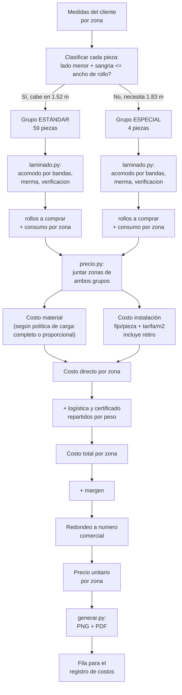

# Flujo del cálculo: de las medidas al precio final

Mapa completo, de punta a punta, para validar el sistema antes de meter costos reales.
Caso de referencia: Tottus Atocongo (63 piezas, 2 anchos de rollo).



## Los dos pasos, con lo que cada uno necesita y lo que entrega

### Paso 1 — `laminado.py` (uno por grupo/ancho de rollo)

| Necesita | Entrega |
|---|---|
| Medidas de cada pieza, ancho y largo del rollo, sangría, merma | Rollos a comprar, consumo por zona, mapa de corte, verificación geométrica |

**Ya validado con el caso real:**

| Grupo | Ancho | Piezas | Rollos | Aprovechado |
|---|---|---|---|---|
| Estándar | 1.52 m | 59 | 3 | 93% (con 10% de merma) |
| Especial | 1.83 m | 4 | 1 | 29% |

### Paso 2 — `precio.py` (junta los grupos, reparte costo y margen)

| Necesita | Entrega |
|---|---|
| Precio de cada rollo, tarifa de mano de obra (fijo/pieza + S/m²), logística, certificado, margen | Costo y precio unitario por cada una de las 14 zonas, sub total, IGV, total |

**Corrido con la estructura real y costos en `null`** — confirma que el cálculo está listo,
solo esperando los números:

```
⚠ NO SE PUEDE CALCULAR EL PRECIO TODAVÍA. Faltan estos datos:
    - tarifa de mano de obra (S/ por pieza + S/ por m², incluye retiro)
    - logística
    - certificado
    - precio del rollo: estándar, especial

  Zona                          Cant    m²    Costo u.  P.unit  Importe
  Altillos (estándar)             33  30.73m        ?       ?        ?
  Comedor empleados (estándar)    12  10.83m        ?       ?        ?
  ...
```

Con costos de prueba, corre sin errores y arma la tabla de 14 filas con las dos filas del
rollo especial identificadas por separado (ver más abajo, "Baño hombres (especial)" y
"Baños mujeres (especial)").

## Qué necesitamos — pendiente para mañana

Estos son datos, no decisiones. Van directo en `costos` y en `precio_rollo` de cada grupo:

- [ ] **Precio del rollo estándar** (1.52 m x 25 m)
- [ ] **Precio del rollo especial** (1.83 m x 25 m, o el ancho que confirme el proveedor)
- [ ] **Tarifa de mano de obra**: S/ fijo por pieza + S/ por m² (incluye retiro, según lo
      decidido — no se separa)
- [ ] **Logística** del trabajo completo (movilidad, viáticos si aplica)
- [ ] **Certificado** — costo de la emisión, si tiene costo aparte

## Vacíos — decisiones que el cálculo necesita y todavía no están tomadas

- [ ] **Política de carga del rollo especial.** El código ya soporta las dos:
  - `"completo"`: se factura el rollo entero a las 4 piezas (precio unitario más alto,
    pero el sobrante —17.7 m— queda como material propio para otro trabajo).
  - `"proporcional"`: solo se factura lo consumido (S/409 de S/1,400 en el ejemplo);
    el resto no se cobra a este cliente. Es lo que mejor calza con "si sobra está bien,
    para que quede algo para otro servicio" — pero hay que confirmarlo explícitamente,
    porque cambia el precio de esas 4 piezas en más del doble.
  - **Queda en `"proporcional"` por defecto en el ejemplo. Confirmar antes de cotizar.**
- [ ] **Confirmar la medida del espejo de 1.74 x 1.74 m** (auditoría del 16/09/2026) —
      exactamente cuadrado, y es el que obliga a comprar el rollo especial.
- [ ] **Ancho real que maneja el proveedor** — se asumió 1.83 m (72", el estándar
      comercial más ancho). Si mañana dice otra cosa, cambia el grupo "especial" entero.
- [ ] **Redondeo del precio unitario** — hoy en S/10. Con costos reales puede que convenga
      subirlo a S/50 o S/100 para que se vea más "cerrado" en la cotización.

## Cómo correr la validación

```bash
# Solo el cálculo de rollos, un grupo a la vez
python3 herramientas/laminado.py herramientas/ejemplo-piezas.json

# El flujo completo (ambos grupos, costo, precio) — hoy con costos en null,
# mañana con los números reales
python3 herramientas/precio.py herramientas/ejemplo-trabajo.json
```
